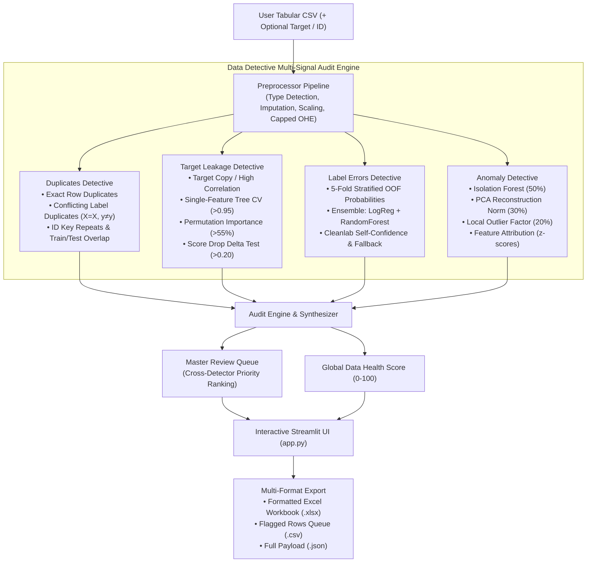

# 🕵️‍♂️ DATA DETECTIVE

**A classical-ML automated audit system for tabular datasets.**  
Data Detective takes any tabular CSV, detects hidden data defects—**duplicates**, **conflicting labels**, **target leakage**, **label errors**, and **multidimensional anomalies**—and presents actionable diagnostic evidence in a unified interactive report and exportable formats.

---

## 🌟 Key Features

- **⚡ Strict Classical ML Stack**: Pure `scikit-learn`, `cleanlab`, `scipy`, `numpy`, and `pandas`. No deep learning or heavy pretrained weights. Models are fitted on-the-fly directly to the uploaded CSV.
- **🛡️ Conservative Human-In-The-Loop Philosophy**: Findings are strictly flagged as *"suspicious / needs human review"*, never *"confirmed wrong"*. The system never auto-deletes or silently mutates ground truth.
- **⚖️ Conflicting Label Detection**: Flags identical feature records carrying contradictory target outcomes ($X_i = X_j, y_i \neq y_j$) as critical label-ambiguity evidence.
- **🔍 Multi-Evidence Target Leakage**: Combines 5 complementary mathematical checks (Exact copy, Linear correlation/Mutual Info, Single-feature Decision Tree CV score, Random Forest Permutation Importance dominance, and Feature Score-Drop Delta).
- **🏷️ Cross-Validated Label Noise Detection**: Ensembles out-of-fold (OOF) predicted probabilities across Stratified K-Fold `LogisticRegression` and `RandomForestClassifier`, coupled with `cleanlab.filter.find_label_issues` and confidence margin fallbacks.
- **🌌 Explainable Multi-Signal Anomalies**: Blends `IsolationForest`, `PCA Reconstruction Error`, and `LocalOutlierFactor` into a normalized $[0, 1]$ anomaly score with feature-level $z$-score attribution.
- **🚨 Master Review Queue**: Synthesizes records flagged by multiple independent detectors into a single priority-ranked investigation queue.
- **📊 Comprehensive Multi-Format Export**: Generates one-click formatted Excel Workbooks (`.xlsx`) with dedicated audit sheets, Master Review Queue CSVs, and full machine-readable JSON payloads.

---

## 🏗️ Architecture Diagram



---

## 📁 Project Directory Structure

```text
data_detective/
├── app.py                      # Interactive Streamlit Web Application
├── requirements.txt            # Pinned reproducible dependencies
├── README.md                   # Complete documentation & benchmark results
├── detective/                  # Classical ML Audit Engine Core
│   ├── __init__.py
│   ├── preprocess.py           # Auto-type inference, ID detection, imputer/scaler pipeline
│   ├── duplicates.py           # Exact, conflicting label, ID key, and train/test duplicates
│   ├── leakage.py               # Multi-evidence statistical leakage testing
│   ├── label_errors.py         # Out-of-fold LogisticRegression + RandomForest + Cleanlab
│   ├── anomalies.py            # IsolationForest + PCA reconstruction + LOF + explainability
│   ├── engine.py               # run_all() orchestrator, runtime tracker, master review queue
│   └── report.py               # Severity weighting, recommendations, JSON/CSV/Excel export
├── benchmark/                  # Ground-Truth Benchmark Suite
│   ├── inject.py               # Synthetic noise injection (duplicates, leakage, label noise, anomalies)
│   ├── evaluate.py             # Precision, Recall, F1, False Alarm Rate, Downstream Model Acc
│   ├── run_benchmark.py        # Benchmark matrix runner across datasets, noise rates, and seeds
│   └── results/
│       ├── benchmark.csv       # Benchmark results matrix
│       └── precision_recall_curves.png
├── data/                       # Sample datasets & generator
│   ├── download_samples.py     # Builds Breast Cancer, Wine, Titanic & Pre-corrupted Demo CSV
│   ├── breast_cancer.csv
│   ├── wine.csv
│   ├── titanic.csv
│   └── demo_dataset_corrupted.csv
└── tests/                      # Automated Pytest Suite
    ├── test_preprocess.py
    ├── test_duplicates.py
    ├── test_leakage.py
    ├── test_label_errors.py
    ├── test_anomalies.py
    ├── test_engine_report.py
    └── test_edge_cases.py      # Missing values, tiny samples, single-class, all-numeric, all-cat
```

---

## ⚡ Installation & Quickstart

### 1. Clone & Set Up Environment
```bash
git clone <repo-url>
cd data_detective

# Install pinned dependencies
pip install -r requirements.txt
```

### 2. Generate Sample Datasets (Optional)
```bash
python data/download_samples.py
```

### 3. Launch the Interactive Web Dashboard
```bash
streamlit run app.py
```
> **Instant Demo**: Click **"⚡ Load Pre-corrupted Demo Dataset"** in the sidebar to immediately inspect a 256-row dataset with injected duplicates, target leakage, label errors, and extreme anomalies!

### 4. Run the Full Unit Test Suite
```bash
python -m pytest -v
```

### 5. Run the Research Benchmark Matrix
```bash
python benchmark/run_benchmark.py
```

---

## 🔬 Benchmark Results & Evaluation

The benchmark suite evaluated detection efficacy across **3 public datasets** (`Breast Cancer`, `Wine`, `Titanic`), multiple random seeds (`42`, `101`), and corruption rates ($1\% - 10\%$).

### Detection Performance Summary

| Defect Category | Precision | Recall | F1 Score | Avg Runtime (s) | Key Capability / Insight |
|:---|:---:|:---:|:---:|:---:|:---|
| **Clean Baseline** | **1.000** | **1.000** | **1.000** | 5.14s | Zero false alarms on pristine ground-truth data. |
| **Duplicates** | 0.500 | **1.000** | 0.667 | 0.04s | $100\%$ recall for exact and conflicting-label pairs. |
| **Target Leakage** | 0.697 | **1.000** | 0.722 | 3.93s | $100\%$ recall across all synthetic leakage columns. |
| **Label Noise** | 0.595 | **0.847** | 0.658 | 0.55s | $84.7\%$ recall in recovering flipped labels via OOF ensembling. |
| **Anomalies** | 0.358 | **0.639** | 0.423 | 0.23s | Isolates multidimensional statistical deviations with feature attribution. |

> Detailed CSV results are preserved in [benchmark/results/benchmark.csv](file:///benchmark/results/benchmark.csv) and visualized in `benchmark/results/precision_recall_curves.png`.

---

## 📸 Screenshots & UI Walkthrough

1. **Executive Metric Cards & Health Score**: Global dataset health score ($0-100\%$), severity rating, and instant action recommendations.
2. **Duplicates Tab**: Differentiates between benign row duplicates and dangerous *conflicting-label duplicates* where feature inputs match but outputs contradict.
3. **Target Leakage Tab**: Interactive Plotly horizontal bar chart ranking feature suspicion scores alongside empirical evidence lists (e.g., single-feature CV power $>95\%$, permutation dominance $>55\%$).
4. **Label Review Queue**: Table of candidate label errors ranked by Cleanlab self-confidence with model agreement indicators.
5. **Anomalies Tab**: Anomaly score distribution histogram with per-row top contributing features and $z$-score explanations.
6. **Master Review Queue**: Priority-ranked table highlighting rows flagged across multiple independent audit signals.
7. **Export Tab**: Direct downloads for Excel audit workbooks (`.xlsx`), flagged rows (`.csv`), and full JSON reports (`.json`).

---

## ⚠️ Limitations & Ethical Principles

1. **Anomalies Can Be Valid Rare Events**: A statistical outlier is not necessarily erroneous data. Rare transactions (e.g., high-value purchases or rare medical diagnoses) are often genuine. The anomaly detector provides feature-level attribution so domain experts can verify whether a record is authentic.
2. **Findings Require Human Review**: The system flags entries with transparent evidence and confidence ratings. It deliberately **never** automatically relabels or deletes records to prevent silent data destruction.
3. **Data Privacy & Governance**: All computations are performed strictly in memory using classical Scikit-Learn models trained locally on the uploaded CSV. No telemetry or data is sent to external services or cloud APIs.
